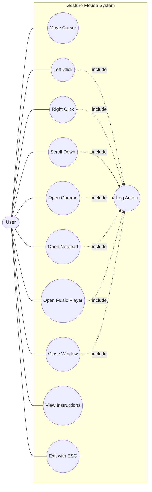
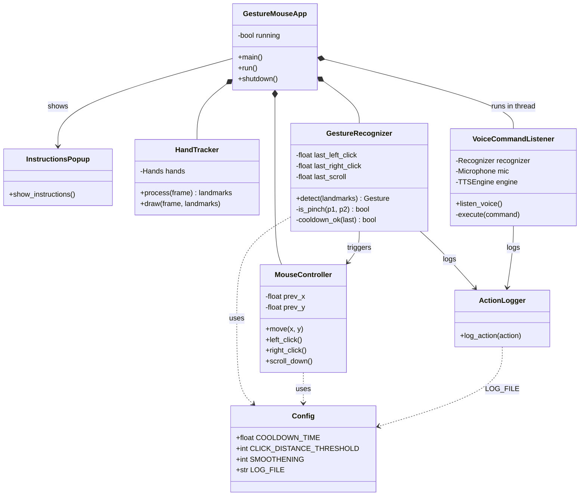
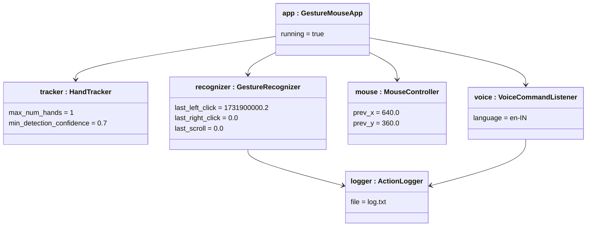
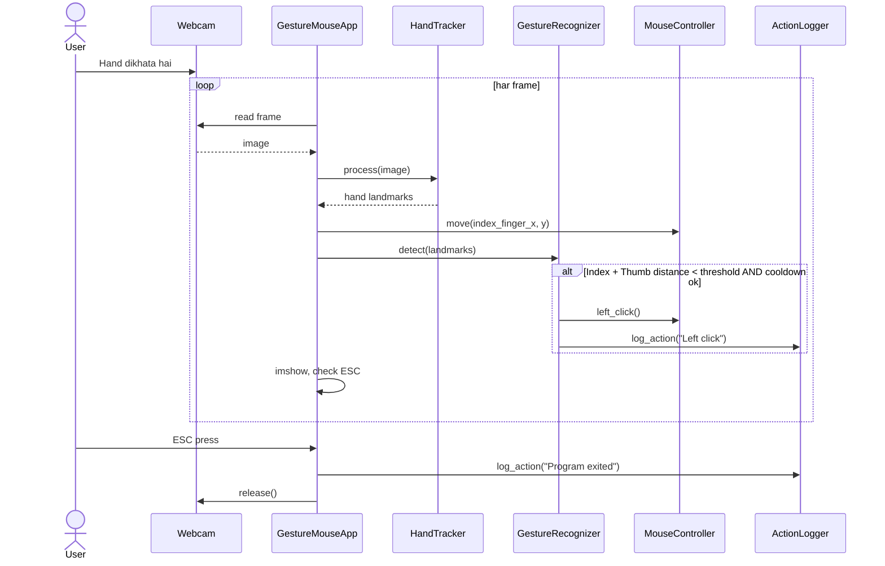
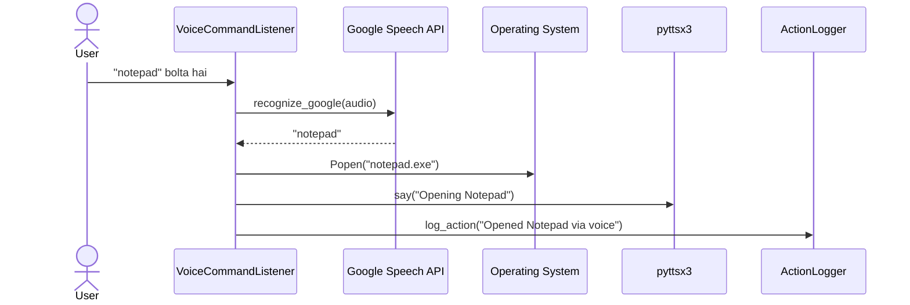
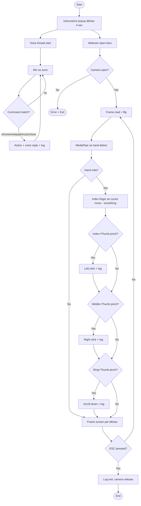
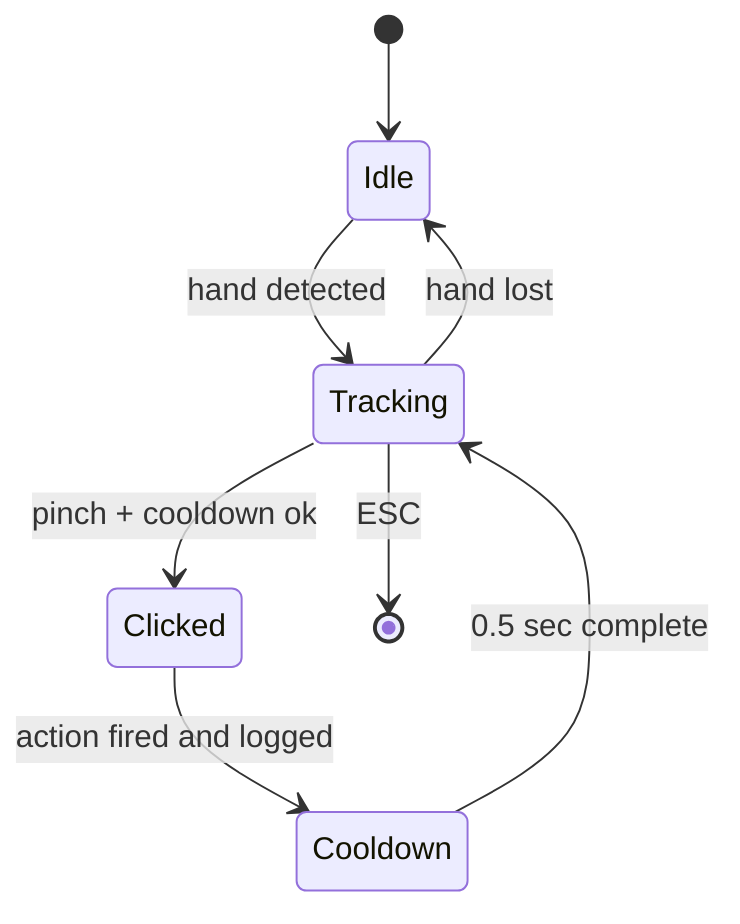
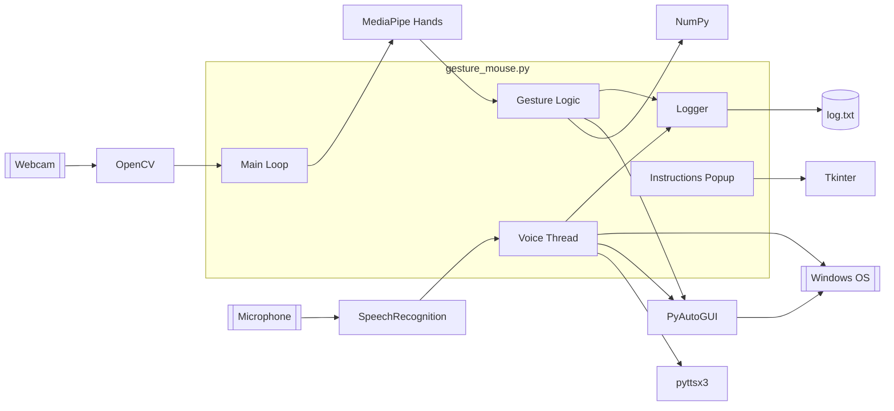
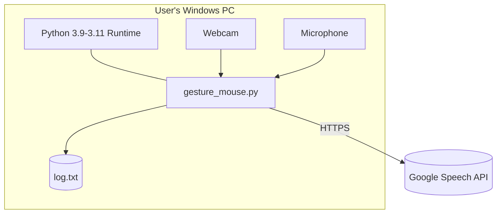

# Gesture Mouse – UML Diagrams (OOAD)

Ye diagrams Mermaid mein bane hain, GitHub par automatically render hote hain.

---

## 1. Use Case Diagram

---

## 2. Class Diagram

---

## 3. Object Diagram

---

## 4. Sequence Diagram (Left Click via Gesture)

### Sequence Diagram (Voice Command)

---

## 5. Activity Diagram

---

## 6. State Diagram (Gesture cooldown)

---

## 7. Component Diagram

---

## 8. Deployment Diagram

